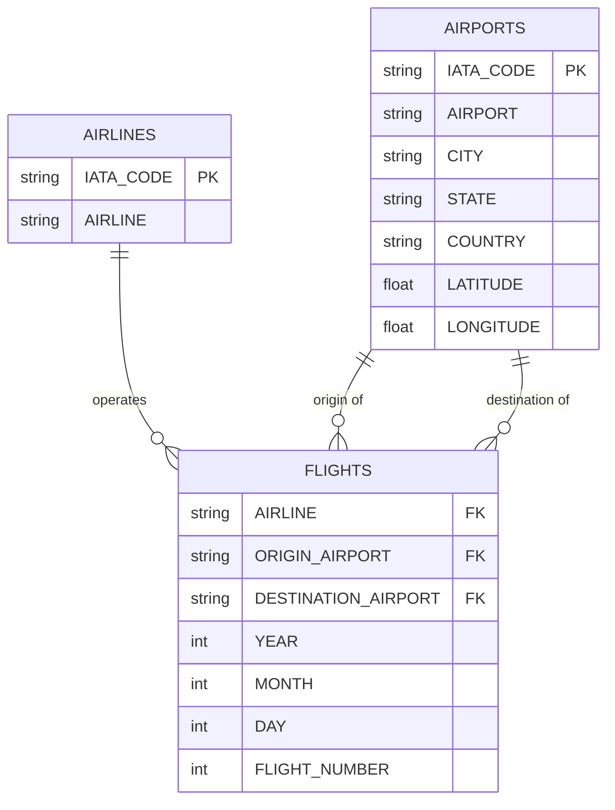

# Flight Dataset Schema
2015 US domestic flights — airlines, airports, and flight records

## 3 tables

358,774 flight records, 322 airports, 14 airlines

## Entity Relationship Diagram

## Foreign Key Relationships

- FLIGHTS .AIRLINE → AIRLINES .IATA_CODE many-to-one Operating carrier
- FLIGHTS .ORIGIN_AIRPORT → AIRPORTS .IATA_CODE many-to-one Departure airport
- FLIGHTS .DESTINATION_AIRPORT → AIRPORTS .IATA_CODE many-to-one Arrival airport

## Table Definitions

### AIRLINES 14 rows

| Column | Type | Description |
| --- | --- | --- |
| IATA_CODE PK | VARCHAR(2) | Two-letter IATA airline code (e.g. `AA`, `UA`) |
| AIRLINE | VARCHAR | Full airline name |

### AIRPORTS 322 rows

| Column | Type | Description |
| --- | --- | --- |
| IATA_CODE PK | VARCHAR(3) | Three-letter IATA airport code (e.g. `LAX`, `JFK`) |
| AIRPORT | VARCHAR | Full airport name |
| CITY | VARCHAR | City the airport serves |
| STATE | VARCHAR(2) | US state abbreviation |
| COUNTRY | VARCHAR | Country (all rows: `USA`) |
| LATITUDE | FLOAT | Geographic latitude in decimal degrees |
| LONGITUDE | FLOAT | Geographic longitude in decimal degrees |

### FLIGHTS 358,774 rows

| Column | Type | Description |
| --- | --- | --- |
| YEAR | INT | Flight year (all rows: 2015) |
| MONTH | INT | Month (1–12) |
| DAY | INT | Day of month (1–31) |
| DAY_OF_WEEK | INT | Day of week (1 = Monday … 7 = Sunday) |
| AIRLINE FK | VARCHAR(2) | IATA airline code → `AIRLINES.IATA_CODE` |
| FLIGHT_NUMBER | INT | Carrier-assigned flight number |
| TAIL_NUMBER | VARCHAR | Aircraft tail/registration number |
| ORIGIN_AIRPORT FK | VARCHAR(3) | Departure airport → `AIRPORTS.IATA_CODE` |
| DESTINATION_AIRPORT FK | VARCHAR(3) | Arrival airport → `AIRPORTS.IATA_CODE` |
| SCHEDULED_DEPARTURE | INT | Scheduled departure time (HHMM) |
| DEPARTURE_TIME | INT | Actual departure time (HHMM) |
| DEPARTURE_DELAY | INT | Departure delay in minutes (negative = early) |
| TAXI_OUT | INT | Taxi-out time in minutes |
| WHEELS_OFF | INT | Wheels-off time (HHMM) |
| SCHEDULED_TIME | INT | Scheduled elapsed flight time in minutes |
| ELAPSED_TIME | INT | Actual elapsed flight time in minutes |
| AIR_TIME | INT | Time in air (wheels-off to wheels-on) in minutes |
| DISTANCE | INT | Flight distance in miles |
| WHEELS_ON | INT | Wheels-on time (HHMM) |
| TAXI_IN | INT | Taxi-in time in minutes |
| SCHEDULED_ARRIVAL | INT | Scheduled arrival time (HHMM) |
| ARRIVAL_TIME | INT | Actual arrival time (HHMM) |
| ARRIVAL_DELAY | INT | Arrival delay in minutes (negative = early) |
| DIVERTED | INT | 1 if flight was diverted, 0 otherwise |
| CANCELLED | INT | 1 if flight was cancelled, 0 otherwise |
| CANCELLATION_REASON | VARCHAR(1) | A = Airline, B = Weather, C = NAS, D = Security |
| AIR_SYSTEM_DELAY | INT | Delay attributed to NAS (minutes) |
| SECURITY_DELAY | INT | Delay attributed to security (minutes) |
| AIRLINE_DELAY | INT | Delay attributed to the airline (minutes) |
| LATE_AIRCRAFT_DELAY | INT | Delay caused by a late incoming aircraft (minutes) |
| WEATHER_DELAY | INT | Delay attributed to weather (minutes) |